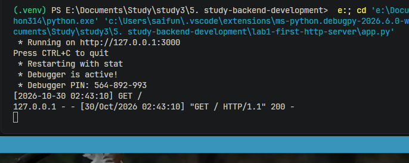
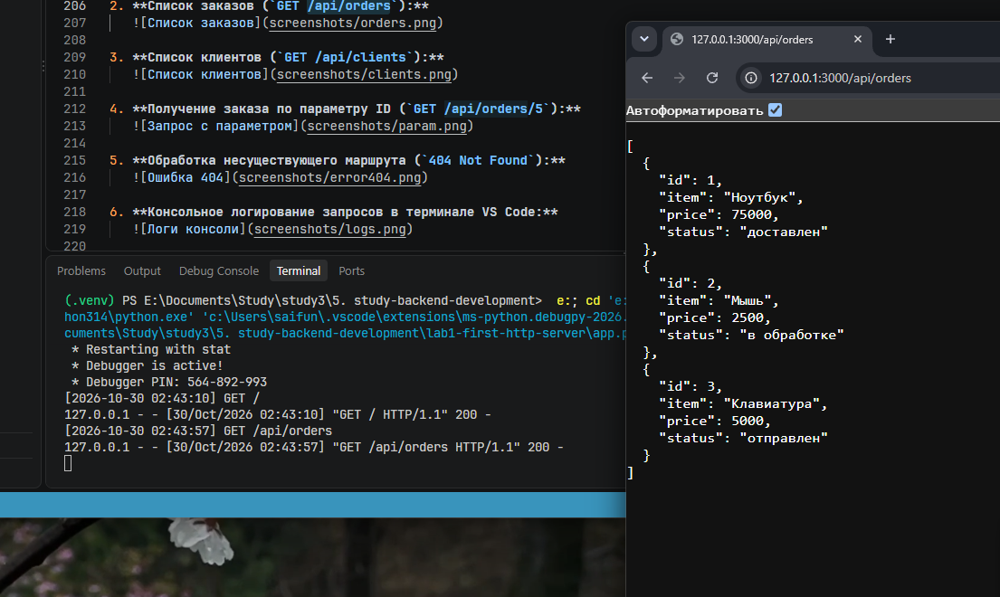
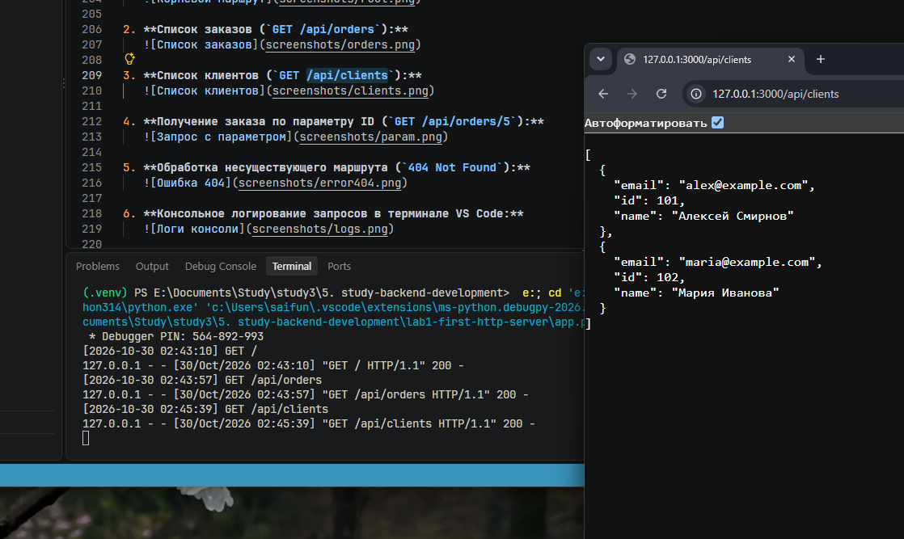
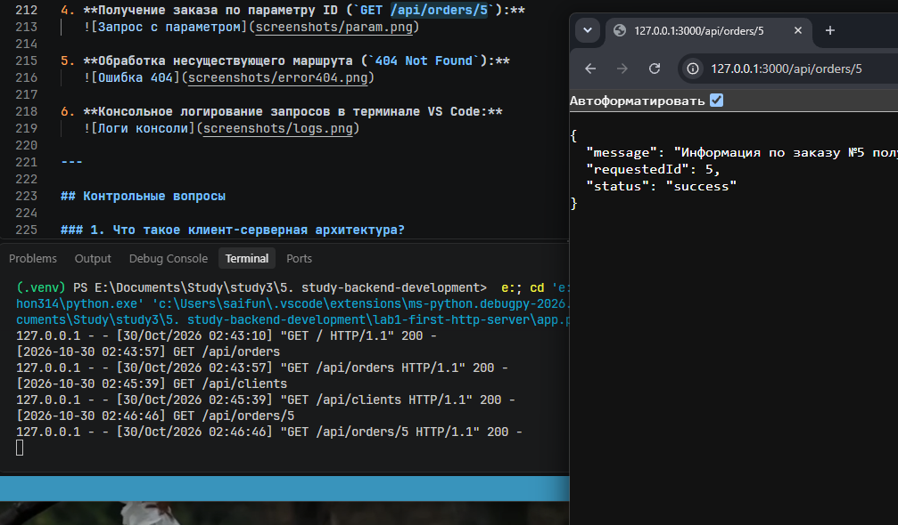
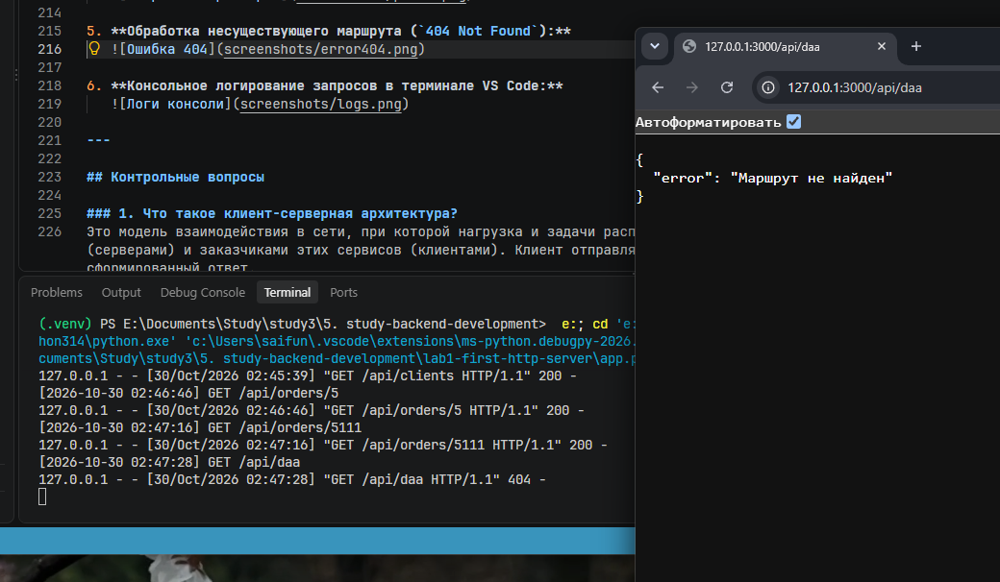
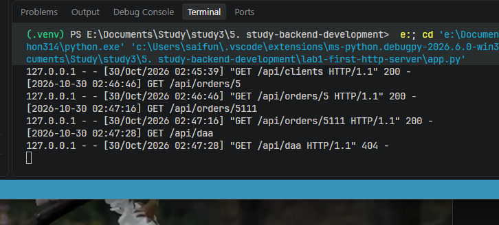

# Лабораторная работа №1: Настройка среды разработки и первый HTTP-сервер

**Студент:** Гаджиев Магомед Исламович  
**Группа:** ПИЖ-б-о-25-2(2)  
**Вариант:** 6 (Продвинутый уровень)  
**Технология:** Python + Flask  

---

## Содержание
1. [Цель работы](#цель-работы)
2. [Теоретическое обоснование](#теоретическое-обоснование)
3. [Выполнение практического примера](#выполнение-практического-примера)
4. [Выполнение индивидуального задания (Вариант 6)](#выполнение-индивидуального-задания-вариант-6)
5. [Контрольные вопросы](#контрольные-вопросы)
6. [Вывод](#вывод)
7. [Список использованных источников](#список-использованных-источников)

---

## Цель работы
Освоить установку инструментов для бэкенд-разработки, создать и запустить минимальный веб-сервер, обрабатывающий GET-запросы, понять концепцию эндпоинтов, научиться настраивать логирование запросов и автоматический перезапуск сервера.

---

## Теоретическое обоснование
Бэкенд (backend) — это серверная часть веб-приложения, отвечающая за обработку запросов от клиентов, взаимодействие с базами данных, выполнение бизнес-логики и формирование ответов. Взаимодействие в веб-разработке строится по клиент-серверной архитектуре: клиент (браузер, мобильное приложение или утилита командной строки) отправляет HTTP-запрос, а сервер принимает его, обрабатывает и возвращает HTTP-ответ.

Обращение клиента к серверу происходит через эндпоинты (endpoints) — конкретные адреса (URL) в связке с методом протокола HTTP (например, `GET /api/users`). Маршрут (route) сопоставляет путь входящего запроса с функцией-обработчиком на стороне сервера. Метод `GET` применяется исключительно для получения данных и обладает свойством идемпотентности, то есть не изменяет состояние сервера. Для передачи структурированных данных в REST API стандартом де-факто является текстовый формат JSON (JavaScript Object Notation).

Для быстрой разработки серверных приложений на языке Python используется микрофреймворк Flask. Он предоставляет удобные декораторы для маршрутизации (`@app.route`), перехвата запросов (`@app.before_request`) и обработки ошибок (`@app.errorhandler`). Для ускорения разработки во Flask предусмотрен режим отладки (`debug=True`), который обеспечивает автоматический перезапуск сервера (Hot Reload) при каждом сохранении изменений в коде.

---

## Выполнение практического примера

### Шаг 1. Настройка среды и установка зависимостей
Команды создания проекта, виртуального окружения и установки Flask в терминале VS Code:

```bash
mkdir lab1-backend
cd lab1-backend
python -m venv venv
.\venv\Scripts\activate
pip install flask
pip freeze > requirements.txt
```

### Шаг 2. Код базового сервера (`app.py`)

```python
from flask import Flask, jsonify, request
import time

app = Flask(__name__)

# Консольное логирование запроса (для продвинутого уровня)
@app.before_request
def log_request():
    print(f"[{time.strftime('%Y-%m-%d %H:%M:%S')}] {request.method} {request.path}")

# 1. Текстовый эндпоинт
@app.route('/')
def home():
    return 'Добро пожаловать на базовый сервер!'

# 2. JSON эндпоинт 1
@app.route('/api/status')
def status():
    return jsonify({"status": "ok", "framework": "Flask"})

# 3. JSON эндпоинт 2 (для среднего уровня)
@app.route('/api/info')
def info():
    return jsonify({"author": "Student", "version": "1.0.0"})

# 4. JSON эндпоинт с параметром (для продвинутого уровня)
@app.route('/api/users/<int:user_id>')
def get_user(user_id):
    return jsonify({"message": "Информация о пользователе", "userId": user_id})

# Обработка 404
@app.errorhandler(404)
def not_found(error):
    return jsonify({"error": "Маршрут не найден"}), 404

if __name__ == '__main__':
    app.run(port=3000, debug=True)
```

### Шаг 3. Запуск и проверка примера
Запуск сервера выполняется командой:
```bash
python app.py
```

Тестирование маршрутов в браузере или через `curl`:
* `http://localhost:3000/` — приветственный текст
* `http://localhost:3000/api/status` — статус сервера в JSON
* `http://localhost:3000/api/info` — информация об авторе и версии
* `http://localhost:3000/api/users/5` — запрос пользователя с `userId: 5`
* `http://localhost:3000/anything-else` — проверка ответа 404

---

## Выполнение индивидуального задания (Вариант 6)

### Условие задания (Повышенный уровень, Вариант 6)
Реализовать HTTP-сервер с автоматическим перезапуском и консольным логированием всех входящих запросов (время, метод, URL), содержащий 5 эндпоинтов:
1. Корневой текстовый эндпоинт `/`.
2. JSON-эндпоинт первой коллекции: `/api/orders` (список заказов).
3. JSON-эндпоинт второй коллекции: `/api/clients` (список клиентов).
4. JSON-эндпоинт с параметром пути: `/api/orders/<int:order_id>` (получение заказа по ID).
5. Обработчик ошибки 404 с возвратом JSON-ответа.

### Структура проекта
```text
lab1-backend/
├── screenshots/            # Скриншоты работы эндпоинтов и консоли
│   ├── root.png
│   ├── orders.png
│   ├── clients.png
│   ├── param.png
│   ├── error404.png
│   └── logs.png
├── venv/                   # Виртуальное окружение Python (в .gitignore)
├── .gitignore              # Исключенные из Git файлы и папки
├── curl_commands.txt       # Команды для тестирования сервера
├── app.py                 # Код сервера по индивидуальному заданию
├── requirements.txt        # Зависимости проекта
└── README.md               # Отчёт по лабораторной работе
```

### Код сервера (`app.py`)

```python
from flask import Flask, jsonify, request
import time

app = Flask(__name__)

# Консольное логирование всех входящих запросов (время + метод + URL)
@app.before_request
def log_request():
    print(f"[{time.strftime('%Y-%m-%d %H:%M:%S')}] {request.method} {request.path}")

# 1. Текстовый корневой эндпоинт
@app.route('/')
def home():
    return 'Добро пожаловать на сервер управления заказами (Вариант 6)!'

# 2. JSON-эндпоинт: Сущность 1 (коллекция заказов)
@app.route('/api/orders')
def get_orders():
    orders = [
        {"id": 1, "item": "Ноутбук", "status": "доставлен", "price": 75000},
        {"id": 2, "item": "Мышь беспроводная", "status": "в обработке", "price": 2500},
        {"id": 3, "item": "Механическая клавиатура", "status": "отправлен", "price": 5500}
    ]
    return jsonify(orders)

# 3. JSON-эндпоинт: Сущность 2 (коллекция клиентов)
@app.route('/api/clients')
def get_clients():
    clients = [
        {"id": 101, "name": "Алексей Смирнов", "email": "alex@example.com"},
        {"id": 102, "name": "Мария Иванова", "email": "maria@example.com"},
    ]
    return jsonify(clients)

# 4. JSON-эндпоинт с параметром пути (заказ по ID)
@app.route('/api/orders/<int:order_id>')
def get_order_by_id(order_id):
    return jsonify({
        "requestedId": order_id,
        "status": "success",
        "message": f"Информация о заказе №{order_id}"
    })

# 5. Кастомная обработка ошибки 404
@app.errorhandler(404)
def not_found(error):
    return jsonify({"error": "Маршрут не найден"}), 404

if __name__ == '__main__':
    # Запуск сервера на порту 3000 с автоматическим перезапуском
    app.run(port=3000, debug=True)
```

### Команды для тестирования (`curl_commands.txt`)
```bash
curl -i http://localhost:3000/
curl -i http://localhost:3000/api/orders
curl -i http://localhost:3000/api/clients
curl -i http://localhost:3000/api/orders/5
curl -i http://localhost:3000/api/orders/ivan
curl -i http://localhost:3000/unknown-route
```

### Скриншоты работы эндпоинтов

1. **Корневой текстовый маршрут (`GET /`):**  
   

2. **Список заказов (`GET /api/orders`):**  
   

3. **Список клиентов (`GET /api/clients`):**  
   

4. **Получение заказа по параметру ID (`GET /api/orders/5`):**  
   

5. **Обработка несуществующего маршрута (`404 Not Found`):**  
   

6. **Консольное логирование запросов в терминале VS Code:**  
   

---

## Контрольные вопросы

### 1. Что такое клиент-серверная архитектура?
Это модель взаимодействия в сети, при которой нагрузка и задачи распределяются между поставщиками ресурсов или сервисов (серверами) и заказчиками этих сервисов (клиентами). Клиент отправляет запрос, а сервер обрабатывает его и возвращает сформированный ответ.

### 2. Какой протокол используется для общения клиента и сервера в вебе?
Используется прикладной протокол передачи данных **HTTP** (HyperText Transfer Protocol) и его защищённое шифрованием расширение **HTTPS**.

### 3. Что такое эндпоинт (endpoint)?
Эндпоинт — это конкретный адрес (URL) в паре с HTTP-методом (например, `GET /api/orders`), по которому клиент обращается к серверу для получения ресурса или выполнения действия.

### 4. Какую структуру имеет HTTP-запрос и HTTP-ответ? Что такое код состояния (status code)?
* **HTTP-запрос** состоит из:
  1. Стартовой строки (HTTP-метод, URI пути, версия протокола).
  2. Заголовков (Headers) — пар «ключ-значение» с метаданными запроса.
  3. Пустой строки-разделителя.
  4. Тела сообщения (Body) — необязательного блока передаваемых данных.
* **HTTP-ответ** состоит из:
  1. Строки состояния (версия протокола, числовой код состояния и краткое текстовое пояснение).
  2. Заголовков ответа (например, `Content-Type: application/json`).
  3. Пустой строки-разделителя.
  4. Тела ответа (возвращаемый клиенту текст, HTML или JSON).
* **Код состояния (status code)** — это трёхзначный числовой код в первой строке ответа сервера, который сообщает клиенту результат выполнения HTTP-запроса.

### 5. Что такое JSON? Почему он популярен в веб-разработке?
**JSON (JavaScript Object Notation)** — это легковесный текстовый формат обмена данными, основанный на синтаксисе объектов JavaScript. Он стал стандартом де-факто для REST API, поскольку легко читается человеком, имеет минимальный объём служебных символов и поддерживается всеми современными языками программирования (включая встроенную сериализацию через `jsonify` во Flask).

### 6. Как запустить сервер на Node.js или Flask?
* **Во Flask (Python):** активировать виртуальное окружение и выполнить в терминале команду `python app.py` (или `python main.py`), где в коде вызывается метод `app.run()`.
* **В Node.js (Express):** выполнить команду `node app.js` (либо `npm start` / `npm run dev`, если соответствующие скрипты прописаны в `package.json`).

### 7. Что такое автоматический перезапуск сервера и зачем он нужен? Какой пакет используется для Node.js?
Автоматический перезапуск (Hot Reload) — это автоматическая перезагрузка серверного процесса при сохранении изменений в исходном коде. Он избавляет разработчика от необходимости вручную останавливать и запускать сервер после каждой правки. В **Node.js** для этого используется пакет **`nodemon`**, а во **Flask** — встроенный параметр **`debug=True`** в методе `app.run()`.

### 8. Какие коды состояния HTTP вы знаете? За что отвечает код 404?
Коды состояния делятся на 5 классов:
* `1xx` — информационные (`100 Continue`);
* `2xx` — успешное выполнение (`200 OK`, `201 Created`);
* `3xx` — перенаправления (`301 Moved Permanently`, `302 Found`);
* `4xx` — клиентские ошибки (`400 Bad Request`, `401 Unauthorized`, `403 Forbidden`, `404 Not Found`);
* `5xx` — серверные ошибки (`500 Internal Server Error`, `502 Bad Gateway`).  
Код **404 (Not Found)** означает, что сервер понял запрос, но не нашёл запрашиваемый ресурс или маршрут по указанному URL.

### 9. Что такое middleware в Express / декораторы запросов во Flask (для продвинутого уровня)?
Это промежуточные обработчики, которые выполняются в жизненном цикле запроса до или после основного обработчика маршрута. В Express для этого используются функции `app.use((req, res, next) => {...})`, а во Flask — декораторы вроде `@app.before_request` и `@app.after_request`. Они применяются для сквозного логирования запросов, аутентификации и проверки прав доступа.

### 10. Как получить параметр из URL-пути (например, ID пользователя) в вашем фреймворке?
Во Flask динамический параметр указывается в угловых скобках внутри строки маршрута (при необходимости с указанием типа данных, например `int`), после чего передаётся одноимённым аргументом в функцию-обработчик:
```python
@app.route('/api/orders/<int:order_id>')
def get_order_by_id(order_id):
    return jsonify({"requestedId": order_id})
```

---

## Вывод
В ходе выполнения лабораторной работы была настроена среда разработки в VS Code, создано изолированное виртуальное окружение Python (`venv`) и изучена правильная организация файловой структуры проекта. На базе фреймворка Flask был разработан HTTP-сервер, реализующий требования продвинутого уровня для 6-го варианта: настроены маршруты для отдачи текста и JSON-коллекций (`/api/orders`, `/api/clients`), реализована передача динамического числового параметра через URL (`/api/orders/<int:order_id>`), добавлен перехват ошибки 404 в формате JSON, а также внедрено консольное логирование каждого запроса через декоратор `@app.before_request` и автоматический перезапуск сервера (`debug=True`). В процессе работы были успешно устранены проблемы с привязкой виртуального окружения в VS Code и непечатаемыми символами кодировки.

---

## Список использованных источников
1. **Flask официальная документация** — [https://flask.palletsprojects.com/](https://flask.palletsprojects.com/)
2. **HTTP протокол (MDN)** — [https://developer.mozilla.org/ru/docs/Web/HTTP](https://developer.mozilla.org/ru/docs/Web/HTTP)
3. **JSON (MDN)** — [https://developer.mozilla.org/ru/docs/Web/JavaScript/Reference/Global_Objects/JSON](https://developer.mozilla.org/ru/docs/Web/JavaScript/Reference/Global_Objects/JSON)
4. **Postman документация** — [https://learning.postman.com/docs/getting-started/introduction/](https://learning.postman.com/docs/getting-started/introduction/)
5. **REST API — основные принципы (GeeksforGeeks)** — [https://www.geeksforgeeks.org/node-js/explain-the-concept-of-restful-apis-in-express/](https://www.geeksforgeeks.org/node-js/explain-the-concept-of-restful-apis-in-express/)